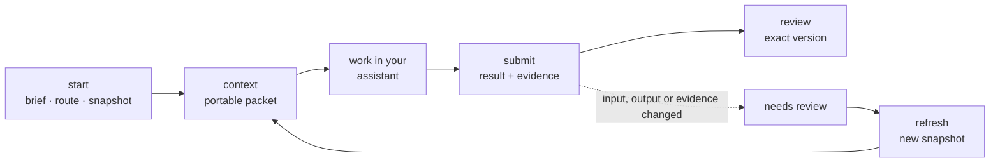

# Relay Method

**Task-sized work, handed off with its boundaries and returned with its evidence.**

Relay is a local, provider-neutral tool for handing a piece of work to an AI assistant, or to another person, and getting back something a reviewer can assess. Each task is a small file-based record: what is wanted, which sources are in scope, how much effort it deserves, what was actually checked, and which version was accepted.

It works with the assistant you already use. Relay prepares the context and records the result; it does not call a model, run commands, or decide that a claim is true.

The entry file, project controls, and packet that an assistant receives are specified as **REF**, the Relay Entry Format ([REF v1](docs/REF.md)). The rest of the lifecycle is the Relay Method.

```text
Open the task → Understand its boundaries → Continue with your assistant → Return reviewable work
```

> Use the least total effort that satisfies the task's requirements, and increase effort when evidence shows it is needed.

**Status: local prototype 0.4.0 with a candidate portable REF skill.** Single user,
loopback only, no authentication. A compatibility release awaits observed client
discovery and handoff checks in the [validation record](docs/ref-validation.md).
See [What is and is not established](#what-is-and-is-not-established).

---

## Why this exists

Work that passes between people and assistants tends to lose the same four things:

- **Boundaries.** Which source is authoritative, and what the assistant may rely on.
- **Currency.** Whether the inputs changed after the work was done.
- **Evidence.** What was actually checked, as opposed to what was claimed.
- **Acceptance.** Which version a reviewer approved, and whether it is still that version.

The usual fixes pull in opposite directions. A shared brief is light but silent about all four. A full staged workflow, such as the six-stage protocol Relay inherits from its predecessor, is rigorous but too heavy for a spelling fix. Relay sits between them: one task-sized unit with a frozen input snapshot, a result bound to evidence, and a review bound to an exact version. The amount of process scales with the task.

If prompts, sources, and decisions already live as files, the handoff can be files as well. A task is a folder of Markdown and JSON that any person or tool can open, diff, and commit.

## Design principles

**One task, one record.** Each task holds its brief, route, input snapshot, submissions, and review events in one place. Another person can resume from the record without reconstructing a conversation.

**Proportional effort.** Rules recommend Direct, Standard, Investigative, or Clarify. A one-word fix does not pay for an investigation, and a short but consequential change still gets strict attention.

**Plain files as the interface.** Packets are Markdown for people and frozen JSON for tools. There is no database and no service to run. State is the folder.

**Evidence over assertion.** A submission needs a result file, a separate evidence file, a description of the checks performed, open questions, and a next action. Relay verifies that these exist and which version they are. It does not verify that they are true.

**Progress, freshness, and acceptance stay separate.** A task can be submitted but stale, or fresh but unreviewed. No single "done" badge hides one of these.

**Control is not data.** Project controls define the workflow. Selected sources are labelled data, and instructions inside them carry no authority.

## How it works

A task moves through five operations. Every one writes to disk, so the state is always readable.



| Step       | Command         | What happens                                                                                                                   |
| ---------- | --------------- | ------------------------------------------------------------------------------------------------------------------------------ |
| Open       | `relay start`   | Validates the brief, selects an effort profile, and snapshots the controls and selected sources with full-file SHA-256 hashes. |
| Understand | `relay context` | Exports the current packet as Markdown. Refuses to export if inputs changed or a blocker is open.                              |
| Continue   | your assistant  | You work outside Relay. Save the deliverable and its evidence as separate files.                                               |
| Return     | `relay submit`  | Binds the result and evidence to the current packet and records the checks, open questions, and next action.                   |
| Review     | `relay review`  | Records a decision on one specific submission by the assigned reviewer.                                                        |

`relay list` and `relay show` recompute freshness at any time.

- **Packet.** The controls plus the sources you select, each hashed over the whole file. A packet that exceeds its character budget fails; nothing is silently omitted. See [REF v1](docs/REF.md).
- **Effort.** Rules recommend Direct, Standard, Investigative, or Clarify, and each task allows one escalation. These are recommendations, not compute limits or permission. See [Routing](docs/RELAY.md#routing).
- **Freshness.** A change to a selected input, a control, the output, or the evidence makes the task due for review. `relay refresh` takes a new snapshot and keeps the history. See [Result and acceptance](docs/RELAY.md#result-and-acceptance).
- **Review.** A decision names one exact submission. Editing the output afterwards means the earlier acceptance no longer applies to it. Reviewer names are self-recorded.
- **Finding sources (experimental).** `relay navigate` suggests knowledge sources, by default without calling a model. It is not a completeness check. See [Navigation](docs/RELAY.md#navigation-experimental) and the [evaluation record](docs/navigate-results.md).

## Observability and portability

Everything Relay knows is on disk, so inspection needs no extra tooling:

```text
.context/
  ENTRY.md · policy.md · project.md · config.json     Project control and authority
  knowledge/                                          Portable concepts (Markdown + YAML)
  runs/                                               Six-stage runs from the original CLI
  relay/tasks/<id>/
    state.json                                        Task, route, freshness inputs, review events
    packets/<sha256>.json                             Frozen input snapshots
    submissions/<sha256>.json                         Result and evidence receipts
deliverables/                                         Versioned results written by the browser UI
```

To see this state without reading JSON, use the local [views](docs/RELAY.md#views) or a read-only [delivery card](docs/RELAY.md#delivery-card).

A project is a folder. Copy it, commit it, or zip it. Writes use a cooperative lock, and JSON files are replaced atomically. Packet creation and state updates are not a single database transaction, so after a crash, inspect the state before clearing a stale lock.

## Where this works

- Sequential tasks that a person reviews: drafts, analyses, specifications, source-backed answers.
- Work that passes between sessions, assistants, or collaborators and should not depend on one chat history.
- Teams that already keep their sources as files and want the handoff to match.

## Where this does not work

- **Managed execution.** Relay does not invoke a worker model, run shell commands, or enforce compute limits.
- **Authenticated, multi-user access.** The interface is loopback-only for a trusted local user. A cloned repository cannot hide confidential folders from whoever holds the clone.
- **Real-time multi-agent coordination.** File handoffs are too slow for tight agent loops.
- **Automated branching.** A person decides the next step between tasks.
- **Cross-task dependency tracking.** Freshness is computed within a task. A graph across runs is future work.

## Relationship to OKF, ICM, and MCP

Relay is an independent implementation. It borrows ideas, not code, and bundles nothing from either project.

| Project                                                             | Contribution to Relay                                                                   | In Relay                                                                       |
| ------------------------------------------------------------------- | --------------------------------------------------------------------------------------- | ------------------------------------------------------------------------------ |
| [OKF](https://github.com/GoogleCloudPlatform/open-knowledge-format) | Knowledge as Markdown with YAML frontmatter, including provenance and freshness signals | `.context/knowledge/` concepts and their metadata checks                       |
| [ICM](https://github.com/RinDig/Interpretable-Context-Methodology)  | Stage contracts, scoped context, and every output being an editable file                | The original six-stage `okf-icm` workflow and Relay's explicit input selection |
| [MCP](https://modelcontextprotocol.io)                              | A different layer: how models reach external tools                                      | Unrelated. A packet can be used inside an assistant that has MCP connections.  |

Relay adds the task-to-review layer: effort routing, evidence-bound submissions, and version-specific acceptance. The OKF-style metadata checks are implemented here. They have not been tested against bundles from the upstream OKF repository. See [ATTRIBUTION.md](ATTRIBUTION.md).

The original `okf-icm` command remains for the detailed six-stage workflow. Relay tasks share its path readers, hashing, section selection, knowledge validation, and lock, and they never complete legacy stages or rewrite an existing stage graph.

## Optional Jev

Relay can ask TypeSafe's [System One](https://docs.typesafe.ai/api/system-one) model for a fast second opinion. It is off by default. Pass `--jev shadow` or `--jev route` on a task, or enable it once for a workspace with the `jev_mode` setting; then it is consulted only where the rules leave a question open, and every call or skip is recorded with its reason. It adds signals for a person and can raise effort. It never grants permission, accepts work, clears a blocker or skips review. Content it judges is sent to the provider. See [Jev](docs/JEV.md).

## Getting started

Requires Python 3.11+. The only runtime dependency is PyYAML, and no model API is needed.

```sh
git clone https://github.com/milo-ve/relay-entry-format.git
cd relay-entry-format
python3 -m venv .venv
source .venv/bin/activate        # Windows PowerShell: .venv\Scripts\Activate.ps1
python -m pip install -e .
```

### Try the synthetic demo

```sh
python examples/relay_demo.py ./relay-demo     # destination must not exist
relay --root ./relay-demo serve
```

Open <http://127.0.0.1:8765>. Open the sample FAQ task, download its context for your assistant, paste the result and the checks you actually ran, and record a review.

### Use it on a real project

```sh
relay init ./my-project --name "My project"
relay --root ./my-project serve
```

`init` refuses to overwrite an existing `.context/`. For task-only use, `relay init ./my-project --minimal` writes a one-stage `config.json`, which makes every packet smaller (see [Minimal workspace](docs/RELAY.md#minimal-workspace)). Read and set `.context/policy.md` and `.context/project.md` before delegating real work: Relay does not discover who holds business authority. An existing compatible workspace can be used directly with `relay --root ./existing-project serve`.

### Assistant skills

Two optional skills connect an assistant to a workspace: `relay-workspace` adapts an existing folder, and `ref` (an implementation candidate) covers task handoffs and resuming work in another assistant. Installing one never modifies a workspace. See [Install the assistant skills](docs/ADOPTION.md#install-the-assistant-skills).

### CLI walkthrough

To walk one task through `start`, `context`, `submit`, and `review` with the CLI, see the [CLI walkthrough](docs/WALKTHROUGH.md).

## Security boundaries

The browser interface binds to `127.0.0.1`, checks Host and Origin, requires a per-server CSRF token, escapes rendered data, sets restrictive response headers, and rejects stale form revisions. It exposes only explicit task operations and packet downloads, with no file server and no shell input.

This is a trusted-user prototype, not an authorization boundary. Do not expose it through a tunnel or shared server. Exports are explicit and common secret paths are refused, but Relay is not a secret scanner, so inspect content before sending it to a person or provider.

## What is and is not established

| Established by offline tests                                   | Not established                                             |
| -------------------------------------------------------------- | ----------------------------------------------------------- |
| Routing rules, freshness, receipts, and review identity fields | Real user time savings                                      |
| Corrupted packets, path boundaries, and symlink handling       | Live Jev quality or calibration                             |
| Provider failures with mocked responses                        | Worker or assistant correctness                             |
| HTTP forms, CSRF, and concurrent-edit handling                 | Resistance to prompt injection in general                   |
|                                                                | Organizational authorization or managed compute enforcement |

The [operational backcast](docs/archive/relay-operational-backcast.md) lists the evidence still required before wider use. Its first gate, one observed collaboration, has not been run.

## Development

```sh
python -m unittest discover -s tests -v
python examples/smoke.py
python examples/relay_smoke.py
```

CI runs the suite and both smoke examples on Linux, macOS, and Windows. Fixtures are synthetic. Live model results and savings need separate, observed evidence. See [CONTRIBUTING.md](CONTRIBUTING.md).

## Documentation

Start at the [documentation index](docs/INDEX.md): one line per document, with when to read it. The two references are [REF v1](docs/REF.md) for the entry, controls, and packet, and the [task-layer protocol](docs/RELAY.md) for the exact behavior of `relay`. Earlier proposals are kept in [docs/archive](docs/archive/).

## License

MIT. See [LICENSE](LICENSE) and [ATTRIBUTION.md](ATTRIBUTION.md). Naming does not imply endorsement by OKF, ICM, or TypeSafe.
