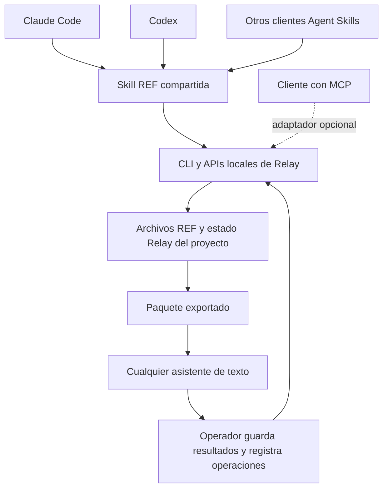

# Plan de entrada REF agnóstica para administrar carpetas

Fecha de investigación: 10 de noviembre de 2026. Revisión 3. Estado: primera entrega implementada localmente como candidata; validación entre clientes y publicación pendientes.

## Evaluación y alcance de ejecución

La arquitectura es adecuada: una skill compartida sobre el CLI evita duplicar
reglas deterministas o añadir un servicio para resolver una invocación. El plan
necesita separar implementación local, observaciones reales de clientes y
publicación. Un test con dos procesos no demuestra continuidad entre modelos;
copiar una skill tampoco demuestra descubrimiento ni equivalencia funcional.

Esta ejecución abarca las entregas 1 y 2 y la preparación de artefactos de la 5:
skill `ref`, referencias, plantilla manual, instalación completa y ZIP, puente
opcional de Claude con respaldo, documentación y fixtures. Conserva el comando
e instalación anterior de `relay-workspace`. La reorganización física (3), MCP
(6) y publicación siguen sus puertas posteriores. El contrato REF v1 y los
controles existentes no se migran.

La entrega 4 sigue siendo una puerta de salida, incluso para esta candidata.
El [registro de validación](../ref-validation.md) distingue checks reproducibles,
versiones de clientes detectadas y pruebas observadas o pendientes. No se
anuncia paridad comprobada mientras falten los recorridos reales ni se publica
una release para saltar esa puerta. Los apartados siguientes conservan la
propuesta y criterios completos; no son una lista de capacidades ya verificadas.

## Recomendación

Crear una entrada REF independiente del asistente: formato y estado compartidos, skill portátil `ref`, CLI existente y adaptadores mínimos por cliente. **Claude Code y Codex serán objetivos obligatorios de la primera versión**, junto con una vía manual para cualquier asistente capaz de recibir texto. Esto sustituye la prioridad anterior de Codex.

Distribuir la misma skill desde esta repo usando el estándar abierto [Agent Skills](https://agentskills.io/specification). Su nombre canónico será `ref`, en minúsculas, conforme al estándar. `/REF` seguirá siendo el nombre de la experiencia deseada; la invocación concreta dependerá de cada interfaz. El núcleo no dependerá de una API de OpenAI o Anthropic, un modelo concreto, hooks propietarios ni memoria de conversación.

El código puede vivir y distribuirse desde GitHub. Un servidor MCP remoto necesita además un proceso desplegado y una vía explícita de acceso a los archivos. Para esta primera versión, la ejecución local aprovecha los permisos y herramientas del asistente que ya tiene abierta la carpeta.

REF sigue nombrando el formato de entrada, controles y paquetes. La skill sería la puerta de entrada al método Relay, cuyo ciclo de tareas incluye evidencia y revisión. Invocarla no implica adoptar automáticamente el protocolo de seis etapas.

## Arquitectura común



| Capa | Responsabilidad | Regla de portabilidad |
| --- | --- | --- |
| REF y Relay | Entrada, controles, paquetes; tareas, evidencia, vigencia y revisión | Mismos archivos y contratos para todos los clientes |
| CLI y biblioteca | Validación, hashes, paquetes y operaciones | Una implementación de las reglas deterministas |
| Skill `ref` | Interpretar la petición y guiar el flujo | Un cuerpo común sin nombres de herramientas exclusivos de un host |
| Adaptadores | Instalación, invocación y descubrimiento | Sólo diferencias necesarias, sin duplicar el método |
| MCP opcional | Exponer operaciones acotadas | Mismo núcleo y estado, sin una segunda base de datos |
| Vía manual | Exportar contexto y recibir trabajo | Útil sin skills, MCP ni shell en el asistente |

La skill comprobará acceso a archivos, CLI, MCP y escritura antes de elegir una vía. Tener instalada una skill no concede acceso al disco. Si sólo hay texto, el operador exportará el paquete y persistirá la devolución; el asistente no afirmará haber administrado directamente la carpeta.

## Matriz de compatibilidad prevista

La documentación confirma mecanismos de integración. Las pruebas de la nueva skill en instalaciones reales quedan pendientes; no se anuncia soporte observado de antemano.

| Entorno | Integración propuesta | Entrada prevista | Alcance |
| --- | --- | --- | --- |
| Claude Code | `ref/` en `.claude/skills/` o `~/.claude/skills/` | `/ref` o petición explícita | Preparación, tareas y organización mediante herramientas locales permitidas |
| Codex CLI/IDE | Mismo contenido base en `.agents/skills/` o `~/.agents/skills/` | `$ref` o `/skills` | Las mismas operaciones y archivos |
| Claude web/Desktop y Cowork | ZIP de la skill o guía manual | Petición de usar REF; selector si corresponde | Archivos disponibles; carpeta local sólo con conexión comprobada |
| Otros clientes Agent Skills | Carpeta portátil y guía del cliente | Sintaxis nativa o petición explícita | Según acceso real a archivos y ejecución |
| Cualquier chat de texto | Paquete REF exportado | «Trabaja con este paquete REF» | Resultado, evidencia y siguiente acción; el operador registra el retorno |
| Cliente MCP sin shell | Adaptador conectado a un workspace accesible | Herramientas; prompt `ref` si admite | Sólo operaciones expuestas y autorizadas |

[Claude documenta la subida de skills como ZIP](https://support.claude.com/en/articles/12512180-use-skills-in-claude); eso es distinto de instalarlas en el directorio local de Claude Code. En [Cowork](https://support.claude.com/en/articles/15520349-use-claude-cowork-on-web-desktop-and-mobile), el acceso a carpetas locales desde sesiones conectadas depende de Desktop y de las condiciones de la sesión. Hay que comprobarlo antes de prometer operaciones sobre la carpeta original. Analizar un ZIP no equivale a modificar esa carpeta.

[Gemini CLI](https://geminicli.com/docs/cli/using-agent-skills/) también documenta directorios de skills y el alias `.agents/skills`: es un candidato posterior para comprobar que añadir un cliente no requiere cambiar el núcleo. No se promete compatibilidad específica con todos los asistentes sin probarlos.

## Qué confirmó la investigación

**La analogía con ICM es válida.** El proyecto upstream [RinDig/icm-architect](https://github.com/RinDig/icm-architect) es una skill con instrucciones, referencias, plantillas y scripts opcionales. Se instala en el directorio de skills del cliente. No necesita un servidor MCP para diseñar o reestructurar un workspace.

Su [SKILL.md](https://raw.githubusercontent.com/RinDig/icm-architect/main/SKILL.md) diferencia creación y reestructuración. Para reestructurar, inventaría, identifica referencias, presenta un mapa de movimientos y valida el resultado. Es una referencia de diseño; esta propuesta no instala ni ejecuta esa skill ni importa sus reglas como controles de Relay.

**La sintaxis depende del cliente.** La [documentación de skills de OpenAI](https://learn.chatgpt.com/docs/build-skills) establece `$nombre` o `/skills` en Codex CLI/IDE, y `@` en ChatGPT. También documenta `.agents/skills/` y `~/.agents/skills/` para descubrimiento local. La documentación de [Claude Code](https://code.claude.com/docs/en/skills) permite `/skill-name`. No se ha validado el alias literal `/REF`, incluidas las mayúsculas, en la instalación del usuario.

La distribución como plugin puede añadir un namespace a la invocación de Claude Code. La instalación directa de la skill será la referencia inicial; los paquetes de cada catálogo serán envoltorios opcionales, no requisitos para usar REF.

**MCP no registra un slash command universal.** La especificación de [prompts MCP](https://modelcontextprotocol.io/specification/2025-06-18/server/prompts) admite plantillas elegidas por el usuario, pero deja su interfaz al cliente. Exponer un prompt `ref` no garantiza que aparezca como `/REF`.

**GitHub distribuye; el runtime ejecuta.** [GitHub Pages](https://docs.github.com/en/pages/getting-started-with-github-pages/what-is-github-pages) sirve contenido estático; de ello se desprende que no basta para ejecutar un backend MCP. Un MCP con código en esta repo podría ejecutarse localmente por STDIO o en un servicio con Streamable HTTP, transportes documentados por [OpenAI](https://learn.chatgpt.com/docs/extend/mcp?surface=cli). Un servicio remoto no obtiene acceso al disco local por recibir una ruta.

**Skill y MCP pueden coexistir.** La [arquitectura de plugins de OpenAI](https://developers.openai.com/plugins/concepts/plugins) distingue instrucciones reutilizables de herramientas conectadas. Recomienda skills cuando las herramientas existentes bastan. Para distribución instalable más amplia, un plugin puede empaquetar la skill y, después, un MCP opcional.

## Base encontrada en esta copia de trabajo

| Pieza | Qué aporta | Qué falta para la experiencia propuesta |
| --- | --- | --- |
| `src/okf_icm/skills/relay-workspace/SKILL.md` | Preparación del workspace mediante CLI | Operación cotidiana, diagnóstico e interfaz `ref` |
| `src/okf_icm/onboarding.py` | Preview, originales de archivos afectados, inventario y adaptación aditiva | Plan de reorganización física y aplicación ligada a ese plan |
| `relay skill --to DIRECTORY` | Copia la skill incluida sin reemplazar contenidos diferentes | Distribución de `ref`, referencias y recursos adicionales |
| `src/okf_icm/relay_cli.py` y `tasks.py` | Tareas, paquetes, entregas, revisiones y vigencia | Guía que seleccione la operación apropiada desde lenguaje natural |
| `docs/REF.md`, `RELAY.md`, `PROTOCOL.md` | Contratos y compatibilidad | Documentar la nueva entrada cuando se implemente |

Hay cambios locales previos y archivos sin seguimiento en esta área. Esta investigación describe el árbol de trabajo observado, no acredita que esas capacidades estén publicadas en GitHub o en una release. El plan no modifica esos cambios.

La adaptación actual mantiene las fuentes en su sitio: modifica `AGENTS.md` y `.gitignore`, y crea `.context` sólo si no existe. Su respaldo contiene originales de archivos modificados y un inventario, no una copia completa del proyecto. Por sí sola no equivale a ordenar todos los archivos.

## Experiencia propuesta

Los siguientes ejemplos expresan la interfaz deseada; aún no son comandos disponibles. Se probarán en Claude Code con `/ref`, en Codex con `$ref` y en la vía manual como peticiones explícitas. El comportamiento será común aunque cambie la sintaxis.

| Petición | Resultado esperado |
| --- | --- |
| `/REF` | Inspeccionar la carpeta actual y explicar su estado y siguiente acción; sin cambios por una invocación vacía |
| `/REF prepara esta carpeta` | Preview de adaptación y aplicación dentro del alcance solicitado, con respaldo previo |
| `/REF administra este trabajo: …` | Interpretar objetivo y criterios, seleccionar fuentes explícitas y usar tareas Relay con ID visible |
| `/REF estado` | Mostrar progreso, vigencia de fuentes, verificaciones reportadas y aceptación por separado |
| `/REF organiza esta carpeta` | Inventario y propuesta de estructura con mapa de rutas; aplicar movimientos sólo dentro de un alcance aprobado |
| `Continúa esta tarea REF en otro asistente` | Recuperar el mismo ID y estado, comprobar vigencia y retomar desde archivos o paquete, sin depender del chat anterior |

La carpeta abierta será el valor por defecto. Una ruta explícita debe resolverse y mostrarse antes de escribir. Si el asistente no tiene acceso a archivos o CLI, seguirá la entrada sin herramientas: solicitar un paquete exportado al operador y declarar qué no pudo inspeccionar.

## Plan de implementación por entregas

### 1. Definir el contrato neutral y validar las entradas

Definir un cuerpo común basado en Agent Skills: leer controles, entender objetivo, seleccionar fuentes y operación, comprobar capacidades y devolver trabajo revisable. Evitar nombres de herramientas de un host, macros como `$ARGUMENTS`, subagentes obligatorios o instrucciones que dependan del historial del chat. Las diferencias de instalación y metadatos irán en adaptadores separados.

Probar el descubrimiento e invocación tanto en Claude Code como en Codex CLI/IDE, además de una entrada manual con paquete exportado. Registrar cliente, versión, sistema, recursos y sintaxis efectiva. Probar `/REF` literal por separado. Si un host no admite el alias, documentar la entrada nativa sin bloquear las demás vías: MCP no resuelve esa limitación por sí mismo.

Entregable: contrato compartido, plantilla de devolución manual y matriz de invocaciones observadas. La utilidad agnóstica y la compatibilidad del alias literal tendrán criterios de aceptación separados.

### 2. Skill compartida e instalación en Claude y Codex

Agregar `src/okf_icm/skills/ref/SKILL.md` con instrucciones breves y referencias cargadas según la operación. Mantener una sola fuente de contenido común, con metadatos de cliente opcionales. Reutilizar `relay-workspace` sin romper su instalación. Extender `relay skill` con selección explícita de skill y destino, preservando el comportamiento por defecto. Copiar todos los recursos necesarios, sin rutas absolutas al checkout de desarrollo ni dependencia de symlinks. Producir también el ZIP para Claude y un paquete manual.

Instalar una skill no adaptará otra carpeta ni alterará configuraciones globales automáticamente. Detectar versiones locales/globales ambiguas y contenidos existentes distintos; no sobrescribir personalizaciones. La primera entrega debe instalarse y probarse en ambos clientes desde artefactos limpios.

Conservar `AGENTS.md` como puente común a `.context/ENTRY.md`. La [documentación de memoria de Claude](https://code.claude.com/docs/en/memory) contempla `AGENTS.md` según versión y configuración, y su importación mediante `@AGENTS.md` desde `CLAUDE.md`. Comprobar el descubrimiento real y, si hace falta, añadir un bloque mínimo con respaldo. Preservar instrucciones existentes; no reemplazar todo `CLAUDE.md` ni copiar los controles a cada archivo de proveedor.

La skill leerá los controles, distinguirá carpetas nuevas, compatibles e incompatibles, y traducirá las peticiones a las operaciones existentes. No duplicará en prompts la lógica de hashes, presupuesto, recibos o vigencia. No inventará responsables ni aceptación. Una petición ambigua producirá diagnóstico y propuesta; una acción concreta ya autorizada podrá avanzar dentro de ese alcance.

Cubrir preparación, `start`, `context`, `list/show`, `submit`, `refresh`, `escalate` y revisión explícita con las mismas reglas. Respetar locks y revisiones en las escrituras. Sin ejecución disponible, entregar al operador acciones pendientes concretas o usar el MCP disponible; no simular la ejecución.

Entregable: paridad funcional entre Claude Code y Codex, preparación repetible y recorrido hasta entrega para revisión; devolución manual que el operador pueda registrar sin inventar checks. Esta entrega administra contexto y trabajo; la reorganización física corresponde a la siguiente.

### 3. Organización física revisable

Agregar primero un plan sin escrituras: árbol propuesto, ruta anterior/nueva, motivo, referencias detectadas, conflictos y operaciones exactas. Limitar la inspección a archivos pertinentes y excluir secretos y estado privado. Declarar referencias externas desconocidas; una búsqueda local no prueba que no existan consumidores fuera de la carpeta.

La aplicación comprobará que el plan sigue vigente mediante hashes, rechazará colisiones incluidas diferencias sólo de mayúsculas, respetará límites de rutas y symlinks, guardará los originales afectados y registrará operaciones para recuperación. El inventario actual no basta como respaldo para esta capacidad. Preservar cambios posteriores al recuperar; no prometer una transacción global del filesystem.

Mantener intactos paquetes, recibos, rutas históricas y grafos existentes. Si un movimiento afecta fuentes de una tarea o etapa, informar su impacto y exigir el tratamiento explícito correspondiente; no reescribir historia para hacerla parecer vigente. Usar el flujo de etapas con salidas mutadas cuando corresponda, o una integración separada, respetando el contrato de entregas de Relay.

Entregable: reorganización sintética con referencias válidas, contenido preservado y recuperación demostrada. Un plan debe poder prepararse en un cliente y aplicarse en otro, revalidando alcance y vigencia. Sin borrado automático ni deduplicación basada sólo en nombres.

### 4. Continuidad entre asistentes como prueba obligatoria

Realizar dos recorridos observados con datos sintéticos: Claude inicia y Codex continúa; Codex inicia y Claude continúa. Usar sesiones nuevas sin copiar historial de conversación. Exportar también un paquete a un asistente de texto y registrar su devolución mediante el operador. Comprobar IDs, fuentes, hashes, evidencia, vigencia y revisión; no exigir respuestas textualmente idénticas.

Entregable: registro de pasos, archivos y verificaciones observadas. El cambio de asistente no debe reiniciar tareas, reinterpretar aceptación ni crear estado duplicado. Añadir después un tercer cliente como prueba de extensión sin tocar el núcleo. Estas observaciones no establecerán ahorros de tiempo ni equivalencia de razonamiento entre modelos.

Esta validación será una puerta de salida en cada versión: primero preparación y tareas; después, cuando exista la capacidad de reorganización física, también sus planes y recuperación. La primera versión no esperará a implementar movimientos para comprobar continuidad.

### 5. Publicación desde GitHub

Documentar instalación con versión o commit identificable y probarla en entornos limpios de ambos clientes. Distribuir CLI, skill completa, ZIP para Claude y guía manual. Comprobar que todos los artefactos incluyan los recursos comunes de la misma fuente. Mantener `relay`, `okf-icm` y `relay-workspace` compatibles. Los plugins de cada ecosistema serán opcionales; ningún catálogo será requisito.

Actualizar README, `docs/RELAY.md` y `docs/REF.md` con la entrada implementada y sus límites. Sin marcador nuevo en proyectos REF v1. Revisar que el artefacto publicado excluya `.context`, respaldos, paquetes privados, claves, entornos y entregables generados.

Entregable: release revisable e instrucciones por cliente; publicación después de superar las pruebas de la versión correspondiente y la revisión solicitada.

### 6. MCP opcional como adaptador común

Si hace falta una interfaz de herramientas para otros clientes, comenzar con un adaptador local STDIO sobre las APIs existentes. Proponer herramientas acotadas de inspección, preview y estado; sumar escrituras con validación de parámetros, raíz fijada al iniciar, locks y control de revisión. No exponer shell arbitrario. Conservar la skill como guía del flujo.

Validar el soporte efectivo en cada cliente anunciado, incluyendo Claude y Codex. Mantener el mismo estado y reglas del CLI, sin una segunda base de datos. El prompt `ref` será una comodidad adicional. MCP será una vía para clientes sin shell o integraciones concretas; no una dependencia obligatoria del formato.

Un servicio remoto sería otro proyecto: definir primero si administra un checkout remoto o usa un agente local, además de autenticación, aislamiento y permisos por proyecto. El servidor web loopback actual no debe exponerse mediante un túnel ni presentarse como ese servicio. No desplegar infraestructura para resolver solamente la invocación `/REF`.

## Criterios de aceptación

- Invocación comprobada en cada cliente anunciado; `/REF` literal sólo donde exista evidencia de soporte.
- Claude Code y Codex incluidos en la primera versión con las mismas funciones; vía manual comprobada sin skills ni MCP.
- Continuidad Claude → Codex y Codex → Claude en sesiones nuevas, con los mismos registros y sin historial de chat.
- Para Claude web/Desktop/Cowork, distinguir skill instalada, archivos disponibles, ejecución y acceso local comprobado; no confundir un ZIP con su carpeta original.
- Preview sin escrituras; aplicación repetida sin duplicación; controles y estado anteriores preservados.
- Preparación con instrucciones existentes, carpeta sin Git, contexto incompatible y cambios locales sin perder.
- Reorganización con destinos ocupados, colisiones de mayúsculas, symlinks, referencias rotas, plan desactualizado y fallo parcial cubiertos con fixtures sintéticas.
- Administración sin confundir selección de fuentes, checks declarados y revisión real; ningún atajo que acepte trabajo por invocar la skill.
- Jev apagado por defecto y activado sólo por petición explícita; núcleo independiente del proveedor.
- Instalación desde el artefacto distribuido y recorrido de orientación en una sesión nueva sin depender del historial del chat.
- Referencias y recursos completos desde cada artefacto instalado, sin depender del checkout de desarrollo. Probar rutas con espacios y CRLF además de las restricciones de rutas existentes.

Para cambios de comportamiento, ejecutar los checks requeridos por la repo:

```sh
python -m unittest discover -s tests -v
python examples/smoke.py
python examples/relay_smoke.py
```

Los tests offline y las pruebas del cliente se reportarán por separado. Un piloto observado podrá evaluar utilidad y tiempo; no inferir ahorros ni calidad de modelos a partir de fixtures.

## Decisiones propuestas para revisión

1. **Primera versión:** núcleo neutral, skill compartida, instalación y paridad en Claude Code y Codex, vía manual, preparación y administración de tareas. La continuidad entre asistentes es requisito de salida.
2. **Segunda entrega:** organización física con plan revisable y recuperación, continuable entre asistentes.
3. **Extensiones:** más clientes, MCP y plugins cuando aporten una capacidad concreta. Hosting remoto fuera del alcance inicial; no condicionar la utilidad agnóstica a ese despliegue.

La implementación local se describe al inicio y en el registro de validación.
Las instalaciones y adaptaciones de prueba usan carpetas sintéticas; no adaptan
automáticamente esta repo ni otros proyectos del usuario. Los criterios de
reorganización, continuidad observada y publicación no se consideran cumplidos
por haber preparado la primera candidata.
