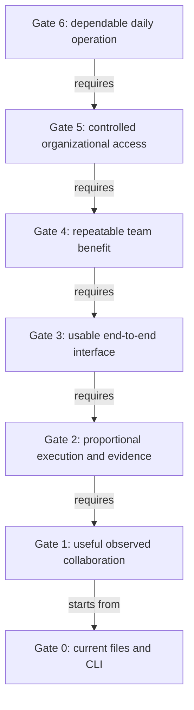

# Relay: backcasting from daily operation to the next practical step

**Planning date:** November 7, 2026, America/Mexico_City.

**Status:** Proposed operating model and evidence-gated backcast. Milestones, owners, and thresholds below are proposals. No software, account, pilot, or deployment was started by writing this document.

**Implementation update (0.3.0):** the local CLI/interface and effort recommendations are now implemented; [README](../../README.md) and [RELAY.md](../RELAY.md) describe the executable slice. The gates below remain unpassed until their specified collaboration and operating evidence is observed.

**Planning horizon:** Approximately six months after an agreed kickoff, followed by expansion only where justified. The week ranges are planning allowances, not delivery commitments. Passing a gate determines progression.

## 1. The destination

One small organization can operate a shared project through individual accounts. Participants navigate permitted projects, open tasks, understand current sources and boundaries, use an appropriate assistant, and return work with inspectable evidence. The system allocates effort and escalates for specific reasons. Another participant can resume the work without reconstructing the original conversation.

**User experience:**

> **Open the task. Understand its boundaries. Continue with your preferred assistant. Return reviewable work.**

**Operating principle:**

> Use the least total effort that satisfies the task’s requirements, and increase effort when evidence shows it is needed.

The initial destination is a dependable environment for one organization of approximately 3–10 contributors. A larger enterprise rollout remains a subsequent decision.

### What “operational” means

| Outcome | Evidence required at the destination |
|---|---|
| People can onboard | A new collaborator correctly identifies a useful next action within 10 minutes, without a private founder walkthrough. |
| Routine tasks stay light | The Direct profile has measurably lower administration than the fuller workflow, while satisfying its applicable checks. |
| Complex work gets attention | Ambiguity, failed checks, and consequential dependencies trigger the specified investigation, escalation, or clarification. |
| Collaboration saves effort | Total coordination, administration, and rework are lower than the shared-brief baseline at comparable quality. |
| Project access is enforced | Unauthorized identities fail the applicable direct-read, search, export, attachment, and derived-content access tests. |
| Work is reviewable | Every submission identifies its actual inputs, output version, checks, and unresolved questions; required acceptance is attributable. |
| Changes remain visible | Seeded changes to recorded dependencies produce the expected review-needed state. |
| The service can be maintained | A named operator can restore data, stop execution, recover interrupted work, and handle an unavailable model endpoint. |
| Use is sustained | The team voluntarily completes recurring work through the system for four consecutive weeks with positive observed net benefit. |

The time and sustained-use thresholds are proposed acceptance targets. A finite set of access or routing tests does not prove the absence of all possible failures.

## 2. A day in the intended operation

Milo opens the project and sees tasks assigned to him, submissions awaiting his review, and work whose recorded inputs changed. A collaborator signs in with their own identity and sees only the projects available to them.

The collaborator opens a task. The brief shows its outcome, authoritative source, owner, applicable permissions, acceptance criteria, and next action. Before preparing context, the service checks access and current source versions.

For a spelling correction, rules select a Direct profile. For a source-backed FAQ, the system selects Standard. If the FAQ sources conflict, it selects or escalates to Investigative, or asks for the missing business decision. A short but consequential price change retains its required review even if generation is trivial.

The participant chooses an execution path:

- **Preferred-assistant path:** export permitted context, work in an existing assistant, and return the result. Relay records the supplied evidence and the limits of what it can observe. It cannot enforce reasoning settings or spend inside an unrelated assistant merely through a prompt.
- **Managed path:** an approved runtime uses selected tools, an allowed worker, and enforceable resource limits. It records actual execution and resource use. A bounded budget permits escalation; exhausting it pauses the task visibly.

The result is checked against the task criteria. Where policy permits, low-risk work may be accepted automatically by defined checks, labeled as automatic acceptance. Required human review remains pending until the designated reviewer acts on the relevant version. A submission, a fresh result, and a human-approved result are distinct states.

At a session change, the next person reads the saved result and next action. If a recorded input changes, Relay identifies affected work within its supported dependency scope. The reviewer assesses impact and records an updated result or a justified disposition.

## 3. Work backward: what must already be true?



The dependencies describe this chosen development path. Security design starts early; institutional controls must be ready before confidential shared use. Jev and multi-agent execution are optional branches, not prerequisites for the destination.

### Gate 6 — The organization can rely on it daily

**Illustrative window:** Weeks 19–24.

**Necessary condition:** Ordinary work continues through an interruption, a source change, an unavailable provider, and a contributor leaving, without losing the task's state or authority boundaries.

**Required operating capabilities:** task queues, accountable support, controlled updates, tested backup/restore, bounded execution, visible failures, and readable export. The active deployment and data schemas have known versions and a rollback or forward-repair procedure.

**Proof:** four weeks of recurring use, a completed restore exercise, a cancellation/recovery exercise, an access-revocation exercise, and measured net benefit. Establish a service availability target from actual team needs before making an availability commitment.

**Accountable roles:** organization owner for value; service operator for reliability; reviewer for accepted work.

**If unmet:** keep a supported pilot and manual export route. Do not broaden the user base while the team depends on hidden founder intervention.

**Working backward:** this requires controlled identities and data boundaries, an established task/result protocol, and a team that has already found the workflow useful.

### Gate 5 — Institutional access is genuinely controlled

**Illustrative window:** Weeks 13–18.

**Necessary condition:** each person and managed agent has an attributable identity; access follows the project boundary across every data path.

**Required capabilities:** existing identity-provider integration, project-level roles, server-side authorization, version-specific review, credential handling, revocation, and access-aware exports. Derivatives and summaries must preserve the applicable audience restrictions unless explicitly released through an authorized process.

**Proof:** exercise at least an administrator, a project contributor, a reviewer, and an unauthorized identity. Verify direct API access as well as the UI. Test a required source becoming unavailable, membership removal, and an attempted cross-project export. Missing authorization must not produce a silently incomplete packet presented as complete.

**Accountable roles:** implementer for the control paths; designated reviewer for access verification; organization owner for role assignments. AI may assist implementation and tests; it cannot supply a human review that did not occur.

**If unmet:** continue only with sanitized, mutually readable projects. A shared or cloned repository cannot enforce confidentiality between folders already distributed to a reader. Revocation prevents future service access; it cannot recall downloaded copies.

**Working backward:** this requires proven project and task boundaries. An entire-company search index is unnecessary for the first institutional deployment.

### Gate 4 — The benefit repeats beyond the founder

**Illustrative window:** Weeks 9–12.

**Necessary condition:** collaborators can operate the workflow without a resident methodology expert.

**Required capabilities:** onboarding, a concise work brief, an appropriate execution profile, understandable failure reasons, returned evidence, and a review queue. Each task has one accountable owner; simultaneous contributions use separate work and deliberate integration.

**Proof:** use three small teams, with at least two observed handoffs each, including interruption or source change. Seek voluntary reuse from at least two teams. Compare against a good shared brief using the same source access and quality rubric. Report founder support, setup, rework, and review time as costs. This sample supplies directional evidence, not general market validation.

**Accountable roles:** Milo as proposed product lead; participating team leads for their work; operator for support records.

**If unmet:** remove ceremony, narrow the task class, or retain the template without the application. If users cannot begin from the brief, adding more agents is unlikely to solve that onboarding failure.

**Working backward:** this requires a complete, usable task-to-review loop and proportionate effort, rather than a collection of disconnected screens.

### Gate 3 — A participant can complete the whole loop

**Illustrative window:** Weeks 5–8.

**Necessary condition:** the participant can perform the four-step experience from a simple local interface.

**Required capabilities:** task view, boundary/source view, context preview/export, result attachment, actual validation status, and version-specific review. Expose the chosen effort profile and a short escalation reason. Keep detailed receipts available without requiring everyone to read them.

**Proof:** a collaborator completes a bounded task without terminal work. Include an altered source, missing evidence, a concurrent-edit conflict, and a failed operation. Errors must remain visible; failed operations must not look completed. Compare displayed freshness with the core CLI result.

**Accountable roles:** implementer for the interface; collaborator for usability observation; Milo for acceptance against the task requirements.

**If unmet:** fix the failing end-to-end path before adding integrations or organization navigation.

**Working backward:** this requires a stable enough task/result contract and executable profile selection, so the interface does not conceal manual decisions that the system cannot actually perform.

### Gate 2 — Effort and evidence are proportional

**Illustrative window:** Weeks 3–4 for a narrow first slice; calibration continues later.

**Necessary condition:** straightforward work takes a short path and complex or consequential work gets appropriate attention, under explicit policy.

**Required capabilities:** Direct, Standard, and Investigative profiles; a Clarify outcome; compact routing records; deterministic permissions/freshness/budget checks; observable escalation triggers; and a consistent submission/review contract. Select and version a profile at run creation. Do not silently rewrite an active dependency graph.

Begin with rules. A first implementation can expose recommendations and manual handoff without claiming control of an external assistant's compute. To demonstrate automatic allocation, add a narrowly managed runtime that actually exposes the required controls. Keep the core independent of that provider.

**Proof:** exercise representative simple, multi-step, ambiguous, and short-but-consequential cases. Confirm that a Direct path avoids unnecessary process while retaining required checks; a failed result triggers the defined escalation; missing authority pauses the affected action; and a resource ceiling stops managed execution. Compare total effort and quality with a fixed capable worker and rules-only baseline.

**Accountable roles:** implementer for the controller; Milo for initial policy; task reviewer for outcome assessment.

**If unmet:** keep a conservative default, diagnose the routing error, and collect more cases. Higher confidence alone is not proof of a correct route.

**Working backward:** this requires observations of actual tasks and their failure modes. A generic “easy versus hard” classifier is insufficient input for an operating policy.

### Gate 1 — One real collaboration is worth repeating

**Illustrative window:** Weeks 1–2.

**Necessary condition:** Milo and one collaborator complete useful work and can explain where the structure helped and where it added overhead.

**Required capabilities:** the existing [first work brief](relay-first-work-brief.md), selected sources, an existing assistant, an actual result, and a reviewer. Manual operation is acceptable when recorded as manual cost.

**Proof:** observe an initial task, a fresh-session resumption, and a declared-source change in a disposable copy. Compare the brief-only baseline with brief plus packets/receipts. Use matched task variants and alternate order where feasible to reduce learning bias.

**Accountable roles:** Milo as proposed owner/reviewer; one collaborator as task contributor; the operator records elapsed time and interventions.

**If unmet:** revise the brief or task selection. Keep the artifacts that help; remove steps with no observed value.

**Working backward:** all prerequisite artifacts exist, but the live collaboration and net benefit remain untested.

### Gate 0 — Current starting point

The project has a synthetic pricing specification, historical workflow evidence, a first collaborator brief, a product proposal, and an adaptive-effort design. The sibling CLI supplies context exports, checkpoints, within-run freshness, and explicit stage skips with reasons.

Automatic effort selection, authenticated organizational access, an application UI, managed agent execution, and a live collaborator pilot remain proposed. These status statements follow the existing project documents; this backcast does not claim a new operational audit.

## 4. The operating contract to establish before adding features

| Operating decision | Owner | Required record or control |
|---|---|---|
| What outcome should this task produce? | Task owner | Brief and observable acceptance criteria. |
| Which source is authoritative? | Project/policy owner | Explicit designation in project control. |
| Who may read, edit, execute, or accept? | Organization/project administrator | Enforced role assignment in hosted operation; honest limitations in manual mode. |
| What effort is appropriate? | Controller within owner-defined policy | Profile, decision basis, allowed tools, limits, and escalation reason. |
| Is the result acceptable? | Designated reviewer or authorized automatic policy | Decision tied to the result, criteria, and input version. |
| What knowledge should persist? | Knowledge steward; initially Milo | Canonical concept with evidence and actual verification status. |
| Who fixes failed or interrupted work? | Operator plus task owner | Visible issue, retained evidence, recovery action, and next step. |

People may hold several roles in the initial team. Their actions and responsibilities should still be distinguishable. An assistant's self-assessment must not impersonate a required independent or human review.

Use separate fields for workflow progress, source freshness, and acceptance. Avoid a single green “done” badge that hides one of these dimensions.

## 5. Daily and weekly operation at the destination

### Per task

1. Establish outcome, owner, boundaries, source authority, and acceptance.
2. Check access and freshness; select the smallest permitted profile expected to satisfy the requirements.
3. Prepare sufficient context and execute in the chosen path.
4. Escalate or clarify when evidence requires it, within the agreed limits.
5. Return the result, actual checks, unresolved issues, and next action.
6. Apply the required review and preserve useful knowledge selectively.

For Direct tasks these actions can be brief, automatic, or combined. They are responsibilities, not six mandatory meetings or reports. Create a handoff when work crosses a boundary, rather than after every trivial action.

### Daily: operator and task owners

Check interrupted runs, blocked tasks, review requests, changed dependencies, and managed-run budget issues. Assign a next action to unresolved items. A day without relevant events should not require a manual audit of every artifact.

### Weekly: product owner and knowledge steward

Review a small sample of accepted results, routing errors, unnecessary escalations, support time, and net benefit. Resolve overdue review items. Update policies deliberately and version the changes. Preserve reusable learning with its actual evidence rather than promoting every task output into knowledge.

## 6. Failure and recovery procedures

| Trigger | Immediate response | Recovery evidence |
|---|---|---|
| Required source changes | Mark recorded consumers for review within supported scope. | Impact disposition or new packet, result, and checks. |
| Required source cannot be accessed | Pause the dependent action or obtain an authorized sanitized source. | Resolved access or explicit limited scope. |
| Worker/provider fails | Save progress and report the failure; use an approved compatible fallback if available. | New attempt associated with the actual provider and outputs. |
| Budget/deadline is exhausted | Stop managed execution; expose current result and next decision. | Explicit budget adjustment, reduced scope, or closure. |
| Contributors edit the same version | Reject silent overwrite and require reconciliation. | Integrated version with refreshed dependent evidence. |
| An output changes after acceptance | Require review of the affected acceptance. | Decision associated with the new version. |
| Unauthorized disclosure is suspected | Stop the affected access/export path and contain relevant credentials or connections. | Incident record, scope assessment, corrected controls, and authorized communication if needed. |
| Application is unavailable | Use a verified backup/export or pause work that requires unavailable access controls. | Recovery check confirming integrity, permissions, and usable task state. |

Local preferred-assistant exports cannot provide remote cancellation or recall. Do not describe those capabilities as present unless a runtime integration actually implements them.

## 7. Where Jev and additional agents enter the backcast

The [adaptive-effort design](../relay-adaptive-effort-and-jev.md) owns the detailed research and controller proposal. This backcast adds sequencing:

| Optional branch | Earliest useful point | Requirement before operational use |
|---|---|---|
| Jev recommendations in shadow mode | Gate 2, once representative tasks and a rules baseline exist. | Current permitted state, versioned questions, logged recommendations, and inspectable errors. |
| Jev changes actual routes | After controlled comparisons. | Better quality/cost/latency tradeoff than rules alone at the task's required quality. Shadow agreement is insufficient. |
| Multiple managed agents | After one worker's complete loop is reliable. | Separable contributions, explicit integration owner, scoped tools, attributable actions, cancellation, and positive net benefit. |
| Central model budget | When managed execution or repeated team demand justifies it. | An approved gateway/provider arrangement, actual metering, and verified enforcement. |
| Cross-run impact tracking | When real work repeatedly depends on other runs. | Explicit dependency semantics and tests for changes, cycles, and stale acceptance. |

None of these branches must delay a useful single-worker collaboration flow. They are adopted through evidence, not by default.

## 8. Measurement and investment decisions

Use the same quality rubric and source access across comparisons. Record human active time separately from end-to-end latency and monetary compute cost; do not add unlike units without an explicit conversion assumption.

```text
Human effort benefit = baseline total human minutes - Relay total human minutes

Total human minutes = clarification + administration + execution + review + rework
```

Report one-time setup separately, then estimate how many similar tasks recover it. For managed execution, count routing, worker, retry, and verification calls. For an external assistant, mark unobservable compute as unknown rather than zero.

Carry forward the proposal's initial gates: useful continuation under 10 minutes, at least 30% less private founder explanation, under five minutes of process overhead per small handoff after setup, no quality regression, and every seeded declared dependency change flagged. These are hypotheses to test, not achieved performance. An observed serious under-routing or access failure requires correction before expanding the affected operating scope.

At each gate, choose **advance, simplify, integrate with an existing tool, or stop**. More features are justified only by an observed constraint on the intended operation.

## 9. The first seven working days

These are proposed actions for the next operating cycle, not activities completed by this backcast.

| Day | Action | Concrete output |
|---|---|---|
| 1 | Milo selects one collaborator and one sanitized project; agree task scope and record the comparison method. | Assigned brief and observation sheet. |
| 2 | Run a matched task using the brief-only baseline. | Deliverable, review, time records, and actual clarification questions. |
| 3 | Run a matched variant using the existing packet/receipt workflow. | Equivalent outputs plus workflow evidence and measured operator cost. |
| 4 | Resume in a fresh session or with another contributor; perform the source-change exercise in a disposable copy. | Observed continuation and declared-dependency results. |
| 5 | Review the evidence and identify the most costly recurring friction. | Gate 1 decision and a short policy draft for Direct/Standard/Investigative work. |
| 6 | If Gate 1 supports proceeding, specify the smallest controller/adapter change needed; otherwise revise the brief and repeat. | One implementation brief with observable acceptance criteria. |
| 7 | Implement and check that bounded slice if ready; otherwise finish the observation cycle. | Reviewable change or a documented reason to simplify. |

Do not begin by adding company-wide ingestion, pooled personal subscriptions, or an autonomous agent network. Their value is assessed later against the working task loop.

## 10. The next build decision

The first software increment should remove the greatest observed manual burden while retaining the canonical sources and existing receipts. If effort selection is the burden, build a rules-based profile selector. If participants cannot find current state, build the task view. If a good brief solves the problem, keep the brief and defer software.

The destination remains the same: a collaborator can enter a shared context, understand the task, use an appropriate assistant and amount of effort, and return work another person can assess and continue.

## Related documents

- [Product proposition and strategy](relay-product-proposal.md).
- [Adaptive effort and Jev](../relay-adaptive-effort-and-jev.md).
- [First collaborator work brief](relay-first-work-brief.md).
